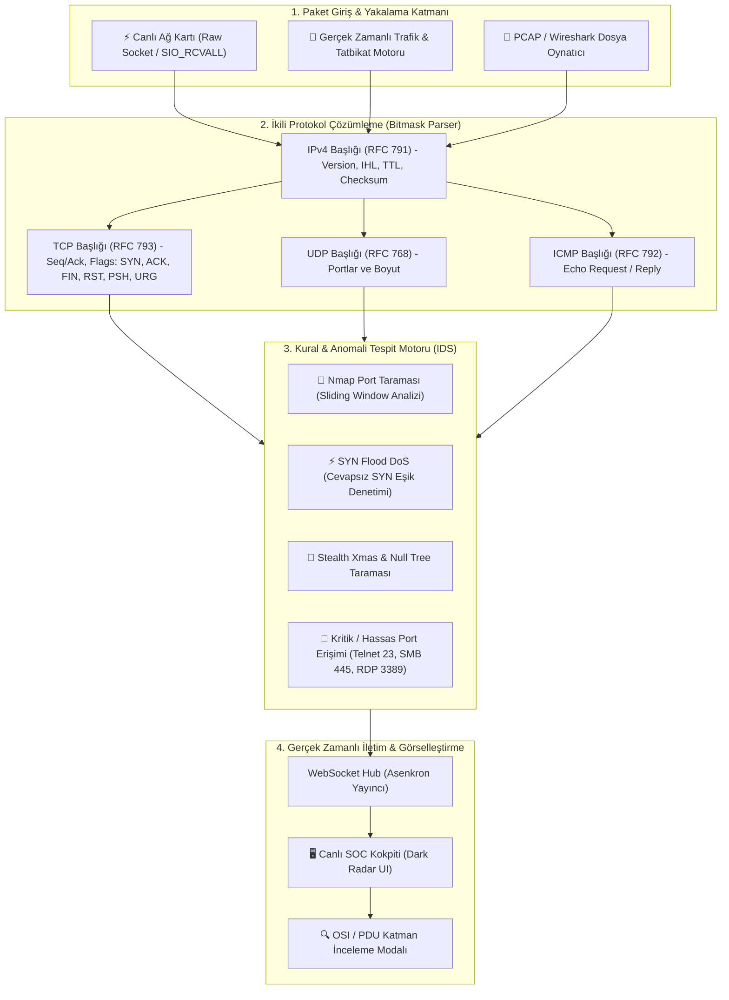

<div align="center">

# 🛡️ SentinelCore
### Otonom Ağ Trafiği İzleme, Paket Analizörü & Saldırı Tespit Sistemi (IDS)
**Cisco Packet Tracer Teorisini Gerçek Hayatta Canlı Savunma Kokpitine Dönüştüren Hibrit Ağ Motoru**

[](https://python.org)
[](https://fastapi.tiangolo.com)
[](https://developer.mozilla.org/en-US/docs/Web/API/WebSockets_API)
[](https://en.wikipedia.org/wiki/Internet_protocol_suite)
[](LICENSE)

<p align="center">
  
  
  
</p>

</div>

---

## 📌 Proje Genel Bakış

**SentinelCore**, fiziksel veya sanal ağ arayüzlerini dinleyerek geçen TCP/IP paketlerini bit seviyesinde ayrıştıran, kural ve anomali tabanlı siber saldırı modellerini (SYN Flood, Nmap Port Taramaları, ICMP Sweep, Gizli Xmas/Null Taramaları) milisaniyeler içinde yakalayan ve **WebSockets** üzerinden canlı bir Güvenlik Operasyon Merkezi (SOC) kokpitine aktaran otonom bir **Saldırı Tespit Sistemidir (IDS)**.

Üniversite **Bilgisayar Ağları** dersindeki teorik ağ protokollerini, Cisco Packet Tracer PDU kapsülleme modellerini ve router/switch kurallarını gerçek dünyada çalışan profesyonel bir yazılım mimarisine dönüştürmek amacıyla geliştirilmiştir.

---

## 🏛️ Mimari ve İstek Akışı (Request Lifecycle)



---

## 🎓 Cisco Packet Tracer & Akademik Kesişim Tablosu

| Ağ Kavramı (Teori) | Cisco Packet Tracer | SentinelCore Uygulaması |
| :--- | :--- | :--- |
| **PDU & Kapsülleme (Encapsulation)** | Simülasyon modunda statik zarf başlıkları (In/Out Layers) | `struct.unpack` ile ağ kartından gelen ham baytların bit bit çözümlenmesi. |
| **ACL (Access Control List)** | Router üzerinde statik paket engelleme kuralları (`access-list`) | Kayan zaman pencereli (Sliding Time Window) dinamik siber anomali analizi. |
| **Switch & MAC Güvenliği** | `show mac-address-table` tablosu | Dinamik ARP ve IP eşleşmelerinin anomali kontrolü. |
| **Taşıma Katmanı Güvenliği** | TCP el sıkışmasının (Handshake) simülasyonu | Tek taraflı SYN flood ve yetkisiz port taramalarının otomatik engelleme alarmları. |

---

## ⚡ Temel Özellikler

- **Çoklu Çalışma Modu:**
  - **Simülasyon & Tatbikat Modu:** Ağ kartı sürücüsü gerekmeden tek tıkla test saldırıları (SYN Flood, Port Scan) üretip görselleştirme.
  - **Canlı Ağ Kartı Modu (Live Raw Socket):** Fiziksel kartı dinleyerek gerçek internet trafiğini analiz etme.
- **İnteraktif OSI / PDU İnceleme Modalı:** Tablodaki herhangi bir pakete tıklandığında Katman 2 (Ethernet), Katman 3 (IPv4), Katman 4 (TCP/UDP) ve Katman 7 (Payload) dökümünü canlı gösterir.
- **Canlı SOC Telemetrisi:** Anlık Paket/Saniye (PPS), Bant Genişliği (Kbps) ve Tehdit Alarmları sayacı.

---

## 🚀 Hızlı Başlangıç

### 1. Kurulum ve Çalıştırma

```bash
# Proje dizinine git
cd C:\Users\pc\Desktop\DERS\SentinelCore

# Sunucuyu başlat
python main.py --port 8050
```

Tarayıcında aç:  
👉 **`http://127.0.0.1:8050`**

### 2. Otomatik Testleri Çalıştırma

```bash
python test_sentinel.py
```

---

## 🛡️ Güvenlik ve Etik Kullanım Bildirimi

Bu yazılım yalnızca eğitim, akademik araştırma ve savunma amaçlı ağ güvenliği analizleri için tasarlanmıştır. Yalnızca izin verilen yerel ağlar veya simülasyon ortamlarında kullanılmalıdır.
